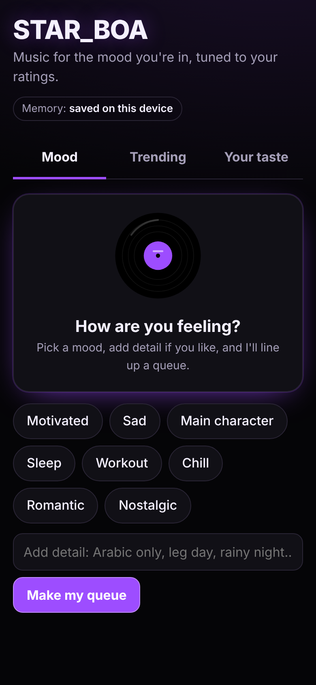
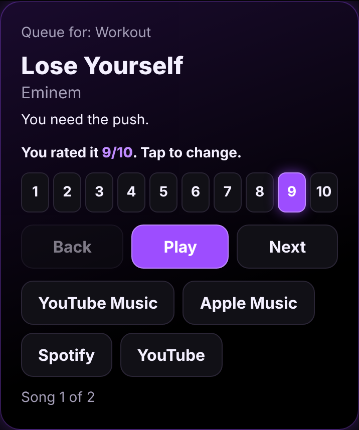

# STAR_BOA

**Music for the mood you're in, tuned to how you rate songs.**

Pick a mood (Motivated, Sad, Main character, Sleep, Workout and more), and STAR_BOA builds a queue that plays automatically in an embedded YouTube player. Rate each song 1–10 as it plays and the next queue gets sharper. Ratings remember the mood they were given in, so a sad song you love doesn't sneak into your workout playlist. The Trending tab shows the current charts and this week's new releases, refreshed automatically.

<p>
  
  
</p>

**Live demo:** _add your Vercel URL here_

## Features

- **Mood-first queues.** 8 moods, each with its own definition (e.g. Workout means 120–160 BPM and no slow songs; Sad means the queue never tries to cheer you up), plus free-text detail like "Arabic only" or "leg day".
- **Per-mood learning.** Every 1–10 rating stores the mood it was given in. The recommender weights same-mood ratings most, and also uses your average rating per genre.
- **Autoplay.** Songs play back-to-back in the YouTube IFrame player; when the queue ends, it fetches more for the same mood. Rating a song 3 or lower skips it.
- **Always current.** `/api/charts` uses Claude with web search to pull the latest Billboard Hot 100, Spotify Global chart and New Music Friday releases. The CDN caches the result for 6 hours, so it stays fresh without a database or cron job.
- **Works where you listen.** One-tap links to YouTube Music, Apple Music, Spotify or YouTube, with your preferred service first.
- **Installable.** A PWA with a manifest, icons and service worker, so you can add it to your home screen like a native app.
- **Private by default.** Your taste profile lives in your browser's localStorage, with copy/paste backup to move between devices.

## How it works

```
Browser (public/)                         Vercel serverless (api/)
┌───────────────────────────┐   POST     ┌──────────────────────────────┐
│ Mood + ratings + profile  │──────────▶ │ /api/picks                   │── Claude API
│ (localStorage)            │ ◀──────────│  builds prompt, validates    │
│                           │   picks    │  JSON, drops repeats         │
│ YouTube IFrame player     │   GET      ├──────────────────────────────┤
│  plays queue, auto-next   │──────────▶ │ /api/youtube  song → videoId │── YouTube Data API
│                           │   GET      ├──────────────────────────────┤   (cached 7 days)
│ Trending tab              │──────────▶ │ /api/charts   web search     │── Claude + web search
└───────────────────────────┘            └──────────────────────────────┘   (cached 6 hours)
```

- `lib/prompt.js` holds all prompt-building and output-cleaning logic as pure functions, so it's unit-tested without network calls.
- API keys never reach the browser. All third-party calls go through the serverless functions.
- An optional `APP_PASSCODE` and a per-IP rate limit stop strangers from spending your API credits.

## Run it locally

Requires Node 22.9+. There are no dependencies to install.

```bash
git clone https://github.com/<you>/star-boa.git
cd star-boa
cp .env.example .env      # add your keys
npm run dev               # http://localhost:3000
npm test                  # unit tests
```

| Variable | Required | What it does |
|---|---|---|
| `ANTHROPIC_API_KEY` | Yes | Mood queues and live charts. Get one at [platform.claude.com](https://platform.claude.com). |
| `YOUTUBE_API_KEY` | For autoplay | Finds each song's video. Enable "YouTube Data API v3" in [Google Cloud Console](https://console.cloud.google.com). Without it, songs open in your music app instead. |
| `CLAUDE_MODEL` | No | Defaults to `claude-sonnet-5-5`. |
| `APP_PASSCODE` | No | Requires a passcode before building queues. |

Without `ANTHROPIC_API_KEY`, the Trending tab falls back to a built-in snapshot in `lib/seed.js`.

## Deploy to Vercel

1. Push this repo to GitHub.
2. On [vercel.com](https://vercel.com), choose **Add New → Project** and import the repo. No framework or build command is needed; `vercel.json` sets everything.
3. Add the environment variables above under **Settings → Environment Variables**.
4. Deploy, then put the URL in the "Live demo" line at the top of this README.

## Project structure

```
api/        serverless routes: picks, charts, youtube
lib/        prompt logic (tested), Claude client, HTTP helpers, fallback chart data
public/     the app: index.html, styles.css, app.js, PWA manifest, service worker, icons
scripts/    zero-dependency local dev server
tests/      node:test unit tests
```

## Known limits

- Mobile browsers pause YouTube playback when the screen locks or the app is in the background. That's a YouTube restriction.
- The YouTube Data API free quota is 10,000 units/day and a search costs 100, so roughly 100 new songs a day. Video IDs are cached in the browser and at the CDN to stretch that.
- Song suggestions come from a language model. They're checked for duplicates and format, but a suggested track can occasionally be wrong. The YouTube lookup skips songs it can't find.

## Roadmap

- Optional accounts (Supabase) to sync ratings across devices
- Export a queue as a YouTube Music or Spotify playlist
- Taste insights page: favourite genres per mood over time

## License

MIT
